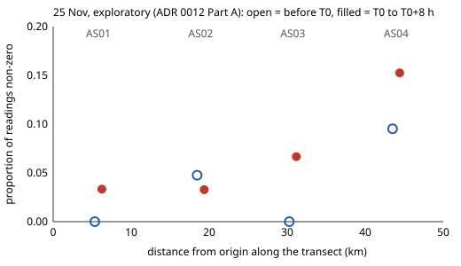

# ADR 0012 Part A: Xact readings by distance, 25 Nov (EXPLORATORY)

Analysis `transect/1`; data cut git `da11702`; T0 2026-11-25T15:00:32+00:00 (ADR 0011).

**Exploratory.** The question was chosen after these by-station counts had been seen (ADR 0009 report). No slope, test or interval is given, by design.

| station | distance | pre-event non-zero | event non-zero | change | pre max | event max (µg/m³) |
|---|---|---|---|---|---|---|
| AS01 | 5.8 km | 0/22 (0.0%) | 2/60 (3.3%) | +0.033 | 0.0000 | 0.0021 |
| AS02 | 18.9 km | 1/21 (4.8%) | 2/61 (3.3%) | -0.015 | 0.0030 | 0.0043 |
| AS03 | 30.7 km | 0/21 (0.0%) | 4/60 (6.7%) | +0.067 | 0.0000 | 0.0043 |
| AS04 | 44.0 km | 2/21 (9.5%) | 9/59 (15.3%) | +0.057 | 0.0063 | 0.0102 |

Limits: EPA has published no detection limit, so "non-zero" is not "detected"; the pre-event window is only 1.5-2 hours per station; four stations, one event. Do not compare individual readings with the lead NAAQS (3-month average).
